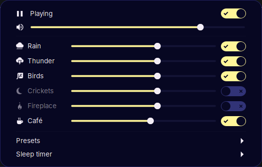
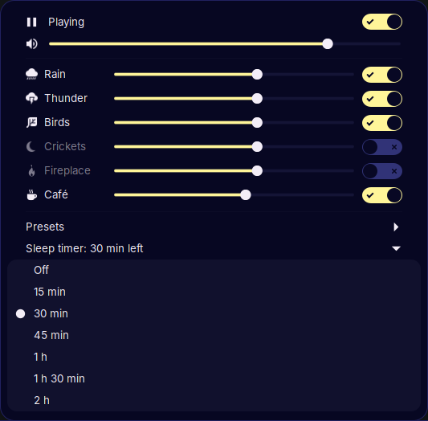

# Ambient Sounds

A Cinnamon panel applet for mixing looping ambient sounds: rain, thunder,
birds, crickets, fireplace and café.

<p>
  
  
</p>

## Features

- Switch each sound on or off and set its level from the panel menu.
- A master volume slider; scroll on the panel icon to change it.
- Presets: Rainy café, Thunderstorm, Campfire night, Cosy cabin, Morning forest.
- Sounds fade in and out (can be turned off in settings).
- Sleep timer (15 min to 2 h) that fades the mix out over its final minute.
  Pressing play during the fade brings it back; pausing cancels the timer.
- Your mix and volume are saved, and can resume automatically at login.
- Middle-click the panel icon to play or pause.

Playback uses GStreamer inside Cinnamon itself, so there is nothing extra to
install and no helper processes. Each sound loops seamlessly using segment
seeks, and per-sound gains even out the loudness of the recordings.

## Side Panel widget

If [Side Panel](https://github.com/PhillipMwaniki/cinnamon-sidepanel) is
installed, Ambient Sounds also shows up there as a widget, with tiles for each
sound, level sliders, presets and the sleep timer. The widget controls this
applet's playback rather than playing anything itself, so the panel menu and
the widget always show the same mix. The applet still needs to be on a panel.

## Install

```sh
ln -s "$PWD/ambient-sounds@PhillipMwaniki" ~/.local/share/cinnamon/applets/
```

Then add **Ambient Sounds** from *System Settings → Applets*.

## Adding sounds

Drop the file into `ambient-sounds@PhillipMwaniki/sounds/` and add an entry to
`library.js` with an id, title, symbolic icon name, filename and gain. Custom
icons go in `icons/` and must end in `-symbolic.svg`.

## Development

Reload the applet after editing:

```sh
gdbus call --session --dest org.Cinnamon --object-path /org/Cinnamon \
  --method org.Cinnamon.Eval \
  "imports.ui.extension.reloadExtension('ambient-sounds@PhillipMwaniki', imports.ui.extension.Type.APPLET)"
```

Modules are loaded with `require()`, which picks up changes on reload.

## Licence

Code is [MIT](LICENSE). The bundled sounds are under the Pixabay Content
License; see [ATTRIBUTION.md](ATTRIBUTION.md) for sources.
